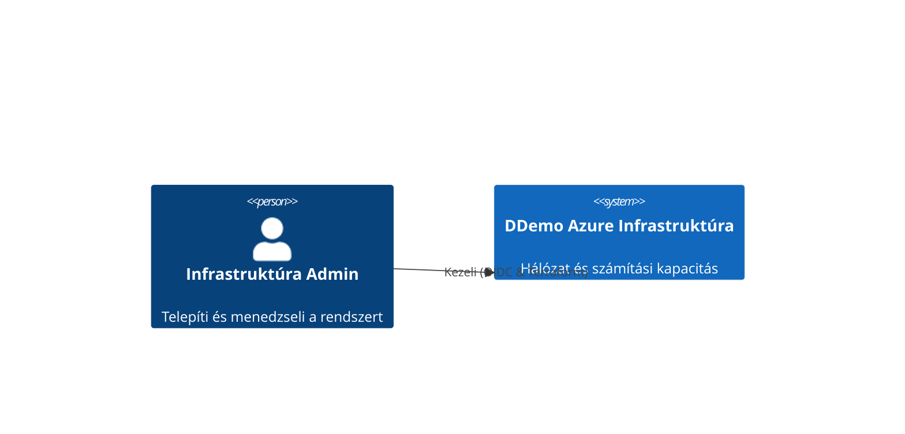

# High-Level Design (HLD): Architecture Overview

## Célok
A DDemo projekt célja egy skálázható, biztonságos és moduláris Azure infrastruktúra létrehozása Terraform segítségével, amely minimális emberi beavatkozással (Zero-Touch) telepíthető.

## Architektúra koncepció
A környezet Hub-and-Spoke jellegű izolációra épül, elkülönítve a hálózati (Network) és a számítási (Compute) erőforrásokat.
- **Hálózat:** Virtuális hálózat (VNet) saját alhálózattal, szigorú hálózati biztonsági csoportokkal (NSG).
- **Compute:** Ubuntu alapú virtuális gépek (VM), automatikusan generált SSH kulcsokkal, OIDC alapú hitelesítéssel támogatott környezetből telepítve.

## Állapotkezelés (Remote State)
A Terraform state fájlok biztonságos, központosított tárolását egy dedikált Azure Storage Account biztosítja, Blob containerben, State Locking támogatással.

## Rendszer kontextus diagram (Mermaid)

